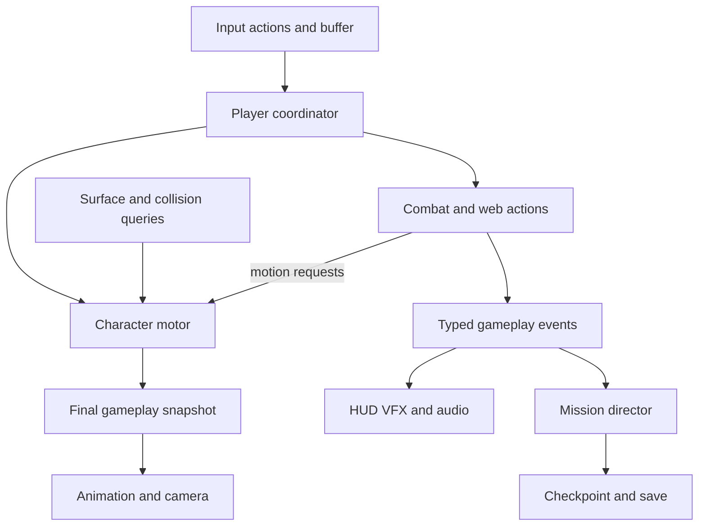

# Build faithful Spider-Man through measured systems

**Use Unity 6, C#, and the Universal Render Pipeline (URP), with a new gameplay implementation informed by the original Windows PC game.** Select and pin an evaluated, supported stable Unity 6 release at setup; the exact editor/package combination remains to be validated. Keep the complete original game as the destination, and prove its first level before producing the rest. Your programming experience transfers well, but traversal, camera design, animation, collision, and asset production need practical learning. Your Ryzen 5 5500, RX 580 8 GB **2048SP**, 16 GB DDR4-3000, and 512 GB NVMe form the initial development/test baseline; **1080p60 is a provisional target, not a benchmark result**. REA can help investigate specific binary questions, but it cannot turn installation files into a complete modern project. Replace promises of “bug-less” and “no lag spikes” with explicit reliability and frame-time acceptance gates.

## Start with movement and a reproducible build

Your first tasks are to establish a clean Win64 build, create a graybox traversal laboratory, and start a reference ledger for the canonical PC edition. Use placeholder characters and buildings. Implement movement, jumping, wall/ceiling transitions, swing/release, and a controllable camera before committing to environment art. In parallel, inventory the complete game's levels, enemies, bosses, mechanics, collectibles, unlocks, cutscenes, menus, save behavior, and ending. This checklist defines “complete”; the first level is a production milestone within that scope.

Unity is the recommended fit for a solo programmer learning game development: conventional C# components, explicit gameplay rules, prefabs, and a bounded scene workflow. URP supplies a rendering foundation across a range of hardware, and Cinemachine provides tracking/framing/blending that you can extend for traversal. Begin with URP, Input System, Cinemachine, and Test Framework; pin mutually compatible stable package versions. ([Unity URP](https://docs.unity3d.com/ja/current/Manual/com.unity.render-pipelines.universal.html), [Cinemachine](https://docs.unity3d.com/Packages/com.unity.cinemachine@3.1/manual/index.html))

Unreal is a fair alternative if its rendering and animation workflow justifies learning C++ and Blueprints; its CharacterMovementComponent includes custom movement hooks, but Spider-Man traversal still requires substantial implementation. Godot offers script-controlled CharacterBody3D and animation blending, making it credible for a scoped visual target; its actual art pipeline and representative scene performance should decide suitability. Neither alternative automatically fixes controls or hitches. For this project, Unity's straightforward C# workflow outweighs changing engines for headline rendering features. ([Epic movement API](https://dev.epicgames.com/documentation/unreal-engine/API/Runtime/Engine/UCharacterMovementComponent), [Godot CharacterBody3D](https://docs.godotengine.org/en/stable/classes/class_characterbody3d.html), [Godot AnimationTree](https://docs.godotengine.org/en/stable/tutorials/animation/animation_tree.html))

Choose modern comic styling or restrained realism: improved silhouettes, animation, materials, lighting, and readable action. Start with baked lighting where practical, limited real-time shadows, and bounded effects. Modern high-detail art still has to be authored or sourced; extracting old meshes cannot recover nonexistent high-resolution art masters. Track free SSD space as imports and builds grow. Do not substitute full RX 580 benchmarks for the 2048SP variant or designate this PC the public minimum before testing.

## One motor and explicit contracts keep gameplay coherent

Use ordinary GameObjects/MonoBehaviours with plain C# rules. Start with Runtime, Editor, and Test assemblies; organize gameplay into folders until dependency/build needs justify more assemblies. A custom ECS, engine fork, networking architecture, or large dependency-injection framework adds little to this single-player starting point.

| Module | Owns | Boundary |
|---|---|---|
| Input adapter | Bindings, sensitivity, buffered intent | Sends commands; knows no level/enemy logic |
| Player coordinator | Acceptance, priority, interruption | Validates commands against state; requests actions |
| Character motor | Capsule movement, velocity, collision, attachment | Sole normal movement writer; publishes final pose/contact |
| Traversal queries | Surface, corner, ledge, anchor candidates | Bounded world queries; returns evidence to motor |
| Combat and health | Hit windows, damage, web resource, stun/death | Deduplicates hits; requests bounded motion |
| Enemy AI | Perception, navigation, attack selection | Uses damage/action contracts; never drives UI |
| Mission director | Objectives, encounters, triggers, completion | Stable IDs and typed gameplay events |
| Persistence | Checkpoints, progression, settings | Versioned data; reconstructs state by stable IDs |
| Camera | Look, obstruction, recenter, framing | Reads motor/surface frame; never moves player |
| Presentation | Animation, VFX, audio, HUD | Observes state/events; cannot decide damage |
| Loading/diagnostics | Readiness, lifetimes, traces | Explicit load ownership and reproducible captures |



Use three orthogonal state axes: **traversal** (`Grounded`, `Airborne`, `SurfaceAttached`, `Swinging`, `ScriptedTraversal`); **action** (`Free`, `Attacking`, `WebAction`, `Interacting`, `Recovery`); and **life/control** (`Alive`, `Stunned`, `Dead`, `Cinematic`, `Paused`). A transition policy handles conflicts: death cancels attacks; an allowed aerial attack retains airborne traversal; pause suppresses gameplay input. Attached traversal stores surface normal, tangent frame, contact, and edge transition data rather than multiplying wall/ceiling/combat combinations into one giant enum.

**Only the motor normally changes the player capsule's position/velocity.** Animation root motion, knockback, and scripted moves submit bounded requests through it. Keep gameplay hit windows authoritative in time-based rules. Unity's CharacterController is useful for the initial ground/air prototype because it moves with collision constraints without Rigidbody forces. Immediately test wall-to-ceiling orientation, corners, thin obstacles, and high-speed contact; if the stock controller cannot satisfy these requirements, replace its backend with a controlled capsule-sweep/slide motor behind the same interface. ([Unity CharacterController](https://docs.unity3d.com/6000.0/Documentation/ScriptReference/CharacterController.html))

Sample and buffer input in `Update`; document the chosen simulation phase, collision synchronization, and interpolation policy. Camera/presentation should consume the final pose consistently, commonly in `LateUpdate`. Fixed stepping alone does not guarantee deterministic playback. Validate movement at different frame rates instead of adding an independent loop prematurely.

**Prototype an arcade swing model first**, tuning acceleration, gravity arc, steering, release impulse, and speed cap. This is a fidelity hypothesis to verify through the PC reference, not a proven description of its internal implementation. Compare attach availability, trajectory, release timing, and gap reachability. A physically simulated rope, wrapping, and mandatory building anchors could alter original routes; adopt those only as a deliberate, tested design change. Web rendering should remain separate from motion authority.

Keyboard/mouse comes first: camera-relative movement, mouse look, saved remaps, sensitivity/inversion, predictable traversal/combat handoffs, quick restart, and configurable hold/toggle behavior. Add measured input forgiveness where wanted and record it as modernization. Unity supports runtime rebinding and saved binding overrides. Keep command types device-neutral for later controller support. Camera tests must cover walls, ceilings, narrow interiors, occlusion, and recentering; offer shake/motion-blur controls and subtitles. ([Unity binding overrides](https://docs.unity3d.com/Packages/com.unity.inputsystem@1.14/manual/ActionBindings.html))

## Keep authored content, live state, and saves distinct

Author movement tuning, attacks, enemies, mission graphs, checkpoints, and content IDs as definitions. ScriptableObjects suit shared authored data; mutable health, current objectives, and cooldowns belong to per-session runtime instances. Saves are separate versioned records containing IDs, progression, checkpoint state, and settings, with migrations and invalid-data handling. ScriptableObjects are not a deployed-player save system. ([Unity ScriptableObject](https://docs.unity3d.com/6000.0/Documentation/Manual/class-ScriptableObject.html))

Mission code consumes semantic events such as `EnemyDefeated`, `PickupCollected`, or `ZoneEntered`, using stable IDs and duplicate-safe completion rules. Small explicit state machines are sufficient for early enemies; navigation supplies paths, the enemy motor supplies motion, and combat supplies damage. Boss-specific rules should be explicit extensions. Checkpoints reconstruct a defined mission state rather than serializing arbitrary scene objects. Write saves through a temporary file with recovery/backup behavior tested against interruption.

```text
Game/
  Assets/_Game/
    Scripts/{Core,Player,Traversal,Combat,AI,Missions,Persistence,Presentation}
    Editor/Importers/
    Tests/{EditMode,PlayMode}/
    Data/{Movement,Attacks,Enemies,Missions,Content}/
    Scenes/{Bootstrap,FrontEnd,TraversalLab,Missions}/
    {Characters,Environment,Animation,Audio,FX,UI,Prefabs}/
  Assets/ThirdParty/
  Packages/{manifest.json,packages-lock.json}
  ProjectSettings/
Tools/{Reference,Import,Build}/
Tests/{Routes,Scenarios,Fixtures}/
Docs/{Design,Architecture,Measurements,Decisions}/
ArtSource/
Licenses/
```

Track source, `.meta` files, dependency locks, authored definitions, and approved assets. Use Git LFS for appropriate large binary source assets; exclude `Library`, `Temp`, logs, builds, and proprietary reference/extraction data. LFS stores pointers separately from binary content, so a reproducible checkout includes fetching those objects. ([GitHub LFS](https://docs.github.com/en/repositories/working-with-files/managing-large-files/about-git-large-file-storage))

Begin with bounded mission scenes and explicit loading boundaries. Add Addressables when asset lifetime or chunk loading warrants it. Keep a loading/readiness state that prepares required content and releases it explicitly; asynchronous loading still requires lifetime management and does not eliminate activation/instantiation work. ([Unity Addressables](https://docs.unity3d.com/Packages/com.unity.addressables@2.9/manual/load-manage-asynchronous-loads.html))

## Reverse engineering supplies evidence through an offline pipeline

**Game files are helpful, but unnecessary for the first prototype; original source is not required.** First request a local inventory, not the entire game: edition/region/language, patch/version, original or modified status, relative paths, sizes, and SHA-256 hashes for executable, DLLs, archives, and relevant data files. Inspect actual binary architecture. Keep the untouched installation outside the repository and write extraction outputs elsewhere.

Use this pipeline: **local reference files → inventory/hash → reviewed extractor → normalized intermediate data plus provenance → Unity editor importer → approved game assets**. Runtime depends only on cooked/new content, never REA, a disassembler, or original archive parsers. Intermediate schemas should record units/axes, IDs, material links, animation timing, collision/trigger annotations, and unsupported fields. Record source build/hash, tool commit/configuration, output hash, confidence, and distribution status. Replacement modern assets can retain stable content IDs without rewriting mission logic.

Existing work deserves investigation before generic binary analysis. `spidey-decomp` targets the PC port, but its README does not establish completeness; dated progress accounts and 32-bit build configuration are useful context, not a compatibility guarantee. `spidey-tools` documents extraction and experimental trigger work. Neversoft Multitool documents PC PKR3 and geometry/animation/trigger conversions, with format-specific limitations. None has been tested on your files here. The PS1 recompilation is a different preservation route and does not establish PC fidelity or modern-remake readiness. ([PC decomp](https://github.com/krystalgamer/spidey-decomp), [2025 checkpoint](https://krystalgamer.github.io/spidey-decomp-status-march/), [spidey-tools](https://github.com/krystalgamer/spidey-tools), [Neversoft Multitool](https://github.com/slfx77/neversoft-multitool), [PS1 recompilation](https://github.com/GTTeancum/SpideyPS1recomp))

**Use [morluto/rea](https://github.com/morluto/rea) optionally for bounded unanswered questions**: a movement constant, loader branch, camera condition, or trigger instruction. It exposes analysis such as pseudocode, strings, calls, and assembly through supported native analysis tools. Its Windows Ghidra integration is experimental, and documented repository-main versus released-package support differs for 32-bit PE. Pin and verify the exact release/provider against the actual executable before relying on it. Local analysis does not mean results stay off the model provider. No compatibility test or installation was performed. ([REA Windows support](https://github.com/morluto/rea/blob/main/docs/windows-ghidra-p0.md), [installation](https://github.com/morluto/rea/blob/main/docs/installation.md))

Maintain a behavior ledger: starting state, input sequence, observation/video timestamp, measurement uncertainty, intended remake behavior, and acceptance scenario. Decompilation returns reconstructed representations, not the original source tree or design intent. Preserve desired behavior while recording deliberate bug fixes. Review each dependency's license before reuse; public repositories are not automatic permission to copy. For eventual public release, owning the game or releasing free/open-source code does not itself clear Spider-Man branding or original assets; keep distributable content rights-cleared and seek appropriate release advice. ([Ownership distinction](https://www.govinfo.gov/content/pkg/USCODE-2024-title17/html/USCODE-2024-title17-chap2-sec202.htm))

## Complete the first level through measurable gates

| Gate | Deliverable and exit criterion |
|---|---|
| 0: Baseline | Pinned toolchain, repeatable Win64 build, canonical-PC inventory, behavior ledger, visual target, full-game coverage matrix |
| 1: Traversal lab | Ground/air/surface/swing transitions, collision recovery, camera and keyboard/mouse pass named graybox routes |
| 2: First playable level | Faithful layout/flow, initial enemy/combat, web interaction, objectives, pickups, checkpoint, death/retry, completion; repeatable start-to-finish playthrough |
| 3: Representative visuals | One complete level at chosen art quality, animation/audio/UI/accessibility, bounded loading and first-use preparation |
| 4: Hardening | Packaged performance route, save/retry regression, cold/warm runs, memory soak, known-issues list meet declared gates |
| 5: Full-game production | Each remaining level/boss/mechanic enters the coverage matrix and passes equivalent content, progression and performance checks |

Use EditMode tests for transition rules, mission event ordering, damage deduplication, import validation, and save migration. Use PlayMode/standalone scenarios for corners/ceilings, fast thin-obstacle collision, attack interruption, camera obstruction, objective completion, checkpoint restoration, and pause/alt-tab/remap behavior. Favor scenario assertions and tolerances over assuming recorded input yields identical physics everywhere. Unity's Test Framework supports EditMode and PlayMode, including standalone-player execution. ([Unity test modes](https://docs.unity3d.com/Packages/com.unity.test-framework@1.4/manual/edit-mode-vs-play-mode-tests.html))

For every meaningful build, compile, run critical tests, validate scene references, build Win64, and launch a packaged smoke route. Script locally before adding hosted CI; Unity supports command-line build entry points. Retain commit ID, settings, logs, and failing traces. ([Unity command line](https://docs.unity3d.com/6000.0/Documentation/Manual/EditorCommandLineArguments.html))

**Provisional performance gate:** on your PC at declared 1080p settings, test a repeatable movement → swing → combat → pickup → checkpoint → death/retry → completion route. At 60 FPS the frame interval is 16.67 ms; initially aim for p95 ≤16.67 ms, p99 ≤20 ms, and no unexplained repeatable frames over 33.3 ms after preparation. Record maximums and every exception. These are proposed acceptance thresholds, not measured capability. Compare three warm runs with a separate first-run/cold-cache run, plus uncapped headroom and actual capped pacing. Report startup/loading/shader preparation separately, with truthful readiness UI.

Profile development builds to diagnose CPU/GPU/GC/loading work, then measure final packaged-player behavior; editor FPS is insufficient. Audit synchronous loads, first-use effects/materials, activation bursts, and allocations. Preload common content, spread expensive activation, and pool only frequently reused measured objects. Set memory/texture budgets from captures with RAM/VRAM headroom. Supported shader preparation depends on the selected Unity release/API; one warmup call is no hitch guarantee. ([Unity profiling](https://docs.unity3d.com/6000.0/Documentation/Manual/profiler-profiling-applications.html), [shader preparation](https://docs.unity3d.com/6000.0/Documentation/Manual/shader-prewarm.html))

Release gates should include zero known crashes, save corruption, progression blockers, or unrecoverable traversal softlocks; passing critical scenarios; and a repeated 60-minute traversal/combat/retry soak without continuing memory growth after warmup. That establishes evidence for named builds and scenarios, never proof of zero bugs. Estimate the complete game's workload only after the first level reveals real animation, art, implementation, and QA throughput. The next information needed is the exact PC edition/file inventory and a visual reference defining “modern”; neither blocks building the traversal laboratory.
